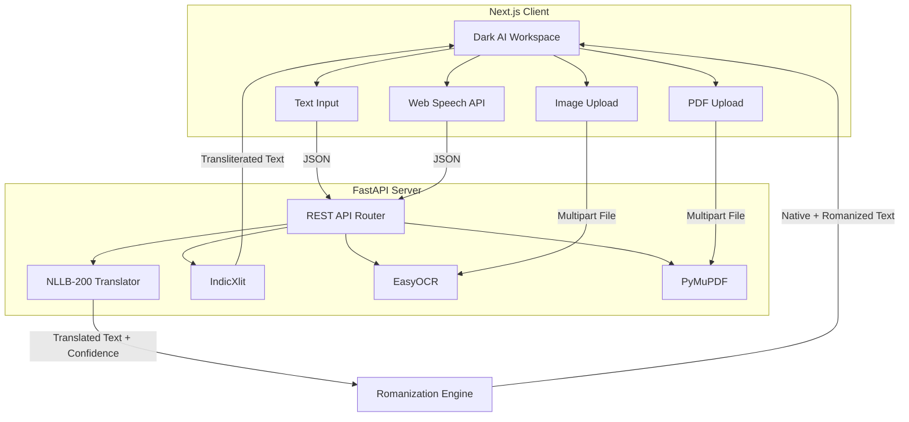

# 🕉️ Omni-Indic Translation Suite

[](https://opensource.org/licenses/MIT)
[](https://www.python.org/)
[](https://fastapi.tiangolo.com/)
[](https://nextjs.org/)
[]()
[]()

**Author:** Seelaboyina Deekshith ([@Deekshith06](https://github.com/Deekshith06))

A comprehensive, multimodal translation and transliteration engine tailored for Indian languages. Built to bridge the communication gap, Omni-Indic supports text, voice, image OCR, and PDF inputs, seamlessly translating English/Tinglish to 7+ major Indian languages.

---

## 🎯 Problem Statement

India is home to unparalleled linguistic diversity, with hundreds of languages and thousands of dialects. While standard English-to-Hindi translation tools are common, accurate translations into regional languages—especially from mixed "Tinglish" (Telugu-English) or other colloquial text formats—remain severely lacking.

Furthermore, traditional translation apps require users to manually type out text. Users interacting with images (signboards, menus), PDF documents, or preferring voice inputs often have to use multiple disparate tools to get a regional translation. The **Omni-Indic Translation Suite** aims to solve this by providing a unified, multimodal platform for seamless regional language translation.

---

## 🚀 Novelty

1. **Multimodal Input Ecosystem**: Instead of just text, users can seamlessly upload PDFs, snap images for OCR, use their voice for real-time dictation, or type—all within a unified workspace.
2. **"Tinglish" & Transliteration Support**: Supports direct script transliteration (converting Latin script to Indic script without changing the meaning) and robust meaning-based translation, accommodating modern informal typing styles.
3. **Audio Output Generation**: Integrated TTS (Text-to-Speech) provides immediate native audio playback for translated text, aiding users who may not read the regional script fluently.
4. **Local & Cloud GPU Flexibility**: Designed to run locally or leverage a Colab GPU backend via ngrok, keeping the heavy ML inference modular and detached from the lightweight frontend.

---

## ✨ Key Features

- **7+ Indic Languages Supported**: Telugu, Tamil, Kannada, Malayalam, Marathi, Punjabi, and Hindi.
- **Multimodal Inputs**:
  - **📝 Text**: Type in English or Tinglish.
  - **🎤 Voice**: Use real-time speech recognition to dictate inputs.
  - **🖼️ Image (OCR)**: Extract and translate text directly from uploaded images.
  - **📄 PDF**: Extract and translate entire documents.
- **Transliteration Toggle**: Instantly switch between translating meaning and transliterating script.
- **Confidence Scores**: Visual green/red bars showing the confidence level of the translation.
- **Post-Translation Romanization**: Generates human-readable English pronunciation for translated Indic text (e.g., "మీరు ఎలా ఉన్నారు" → "meeru ela unnaru") to help non-native readers.
- **Text-to-Speech (TTS)**: Listen to translations in the target language's native accent.
- **Dark AI SaaS UI**: A polished, premium, and sleek dark mode user interface inspired by modern AI tools, built with Next.js and Tailwind.

---

## 💻 Tech Stack

### Frontend
- **Framework**: Next.js 16 (App Router), React
- **Language**: TypeScript
- **Styling**: Tailwind CSS (Premium Dark AI Theme)
- **Voice API**: Web Speech API

### Backend
- **Framework**: FastAPI, Uvicorn
- **Language**: Python 3.12
- **Concurrency**: `run_in_threadpool` for non-blocking ML inference

### Machine Learning Engine
- **Core ML Framework**: PyTorch
- **Transformers**: Hugging Face `transformers`
- **Translation**: Meta's `facebook/nllb-200-distilled-600M`
- **Hybrid Transliteration**: AI4Bharat's `IndicXlit` + Phonetic Fallback
- **Romanization**: Aksharamukha ISO mapping with Custom Phonetics
- **OCR Engine**: `EasyOCR` (CRAFT + CRNN)
- **Document Processing**: `PyMuPDF`
- **Audio Generation**: `gTTS` (Google Text-to-Speech)

---

## 🧠 Models Used

The core intelligence of Omni-Indic is powered by state-of-the-art open-source machine learning models:

* **Translation Engine**: **`facebook/nllb-200-distilled-600M`** 
  * Meta's "No Language Left Behind" seq2seq transformer. Capable of high-accuracy translation across 200+ languages. Runs in `float16` precision for optimal GPU memory usage.
* **Transliteration Engine**: **`IndicXlit` (AI4Bharat)**
  * A specialized transformer model for highly accurate, context-aware transliteration between English and 20+ Indic scripts.
* **OCR (Optical Character Recognition)**: **`EasyOCR`**
  * Uses CRAFT for text detection and a CRNN for text recognition, capable of extracting text from complex image backgrounds.

---

## 🏗️ Architecture

The application is built on a decoupled, full-stack architecture ensuring high performance and modularity:



---

## 📁 Project Structure

```text
Omni-Indic/
├── api/                          # FastAPI Backend
│   ├── main.py                   # App entry, CORS, model preloading
│   ├── routers/                  # API endpoint definitions
│   │   ├── translate.py          # /translate-text, /translate-doc endpoints
│   │   └── tts.py                # /generate-tts endpoint
│   ├── requirements.txt          # Python dependencies
│   └── .env.example              # Environment variables template
├── ml_engine/                    # Machine Learning Inference Logic
│   ├── advanced_translit/        # V3 Hybrid Transliteration Engine
│   ├── romanization/             # Post-Translation Romanized Output Engine
│   ├── translator.py             # NLLB-200 translation wrapper
│   ├── transliterator.py         # IndicXlit transliteration wrapper
│   ├── ocr_processor.py          # EasyOCR image OCR wrapper
│   ├── pdf_processor.py          # PyMuPDF document extraction
│   └── language_config.py        # Language mapping and registry
├── frontend/                     # Next.js UI
│   ├── src/app/                  # App router pages and layouts
│   ├── src/components/           # Reusable UI components (Sidebar, Panels)
│   ├── src/lib/                  # API client helpers
│   └── src/types/                # TypeScript interfaces
├── Omni_Indic_Backend.ipynb      # Colab notebook for GPU hosting
├── gpu_backend.py                # Standalone Python script for GPU hosting
├── gpu_requirements.txt          # Requirements for standalone GPU hosting
└── README.md                     # Project documentation
```

---

## 🛠️ Setup & Installation

### 1. Backend Setup
```bash
# Activate virtual environment
source omni_env/bin/activate

# Install dependencies
pip install -r api/requirements.txt

# Run the server
cd api && uvicorn main:app --host 0.0.0.0 --port 8000 --reload
```

*Note: For GPU acceleration, use the provided `Omni_Indic_Backend.ipynb` in Google Colab or run `python gpu_backend.py` locally.*

### 2. Frontend Setup
```bash
cd frontend

# Install dependencies
npm install

# Run the Next.js development server
npm run dev
```

Visit `http://localhost:3000` to access the suite.

---

## 👤 Author

**Seelaboyina Deekshith**
- GitHub: [@Deekshith06](https://github.com/Deekshith06)
- Repository: [OMNI-INDIC-Translation-Suite](https://github.com/Deekshith06/OMNI-INDIC-Translation-Suite)

